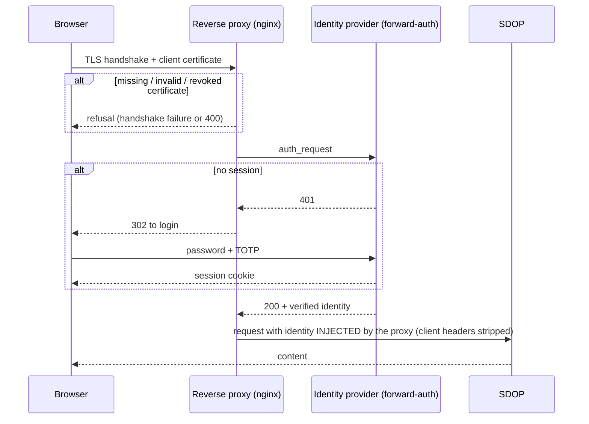

# SDOP — Architecture and security model

SDOP distributes sensitive documents classified under TLP 2.0 (RED, AMBER+STRICT, AMBER)
to third parties, typically incident-response reports sent by a CSIRT to the organisations
it helps. This document explains **what SDOP guarantees, how, and what it deliberately does
not**. Operational details live next to the code; the identity contract SDOP expects from
its front proxy is in [`docs/contrat-identite.md`](docs/contrat-identite.md) (French).

> **The backend never trusts the client for its identity.**
> Everything else — mTLS, identity provider, header stripping, ledger — exists to make that
> sentence true and checkable.

## 1. Posture

SDOP targets small security teams: sensitive documents, a few hundred users, no dedicated
SOC, no formal accreditation. Security must be **credible, demonstrable and sustainable by a
small team** — not maximal.

| Principle | In practice |
|---|---|
| Proportionality | No HA, no HSM, no 24/7 SOC. Simple controls that cover the real threats. |
| Technical honesty | SDOP does not claim to prevent what a browser cannot prevent (screenshots, photos). It **attributes** instead of forbidding. |
| Rebuildability | Everything is code. Disaster recovery = redeploy from the repository + restore data. |

Frameworks used as a compass, not a claim of compliance: ANSSI hygiene guide, CNIL
guidance on personal data security, ISO/IEC 27002:2022 control vocabulary, NIS2.

## 2. Threat model

### 2.1 Threats the deployment must counter

| # | Threat | Typical vector | Control |
|---|---|---|---|
| T1 | Application-level identity spoofing | Client-supplied `X-Authentik-Username` | Proxy strips and re-injects every trusted header (§4) |
| T2 | Stolen credentials | Phishing, credential stuffing | MFA at the identity provider **and** client certificate (§3) |
| T3 | Access from an unmanaged device | Valid credentials used elsewhere | mTLS client certificate: refused by the proxy (handshake failure or HTTP 400), never relayed to SDOP |
| T4 | Container escape | Mounted `docker.sock`, root containers | No socket mounts, non-root, `no-new-privileges`, `cap_drop: ALL`, read-only root FS |
| T5 | Lateral movement | Compromised container reaching the backend directly | Backend reachable only from the proxy network (§5) |
| T6 | Secrets leaking through the repository | Accidental commit | `.env` and secrets ignored, placeholders only, secret scanning |
| T7 | Unverifiable TLS / internal MITM | Ad-hoc self-signed certificates | Internal PKI, verified chains everywhere, including tests |

T4–T7 are mostly provided by the hosting platform; SDOP consumes them. T1–T3 are what SDOP
**requires** from its front proxy and identity provider. These are requirements on a
deployment, not properties the autonomous demo provides: it has no real identity provider.

### 2.2 Out of scope

- **Exfiltration by a legitimate reader** (screenshot, photo): not preventable in a
  browser. SDOP makes every rendering nominative and logged, so a leaked page or export
  carries its reader's marks. A cropped fragment may carry none, and a mark designates the
  account a copy was issued to — not who leaked it.
- **A compromised client device** holding certificate and session: outside the model;
  mitigated by revocation and by attribution.
- **Detection** (alerting, correlation): SDOP exports events (§9); detection belongs to the
  operator's SIEM.

## 3. Authentication chain — three layers, in this order

| Layer | Factor | Verified by | Failure |
|---|---|---|---|
| 1. mTLS client certificate | Possession (device) | Reverse proxy, internal CA chain + CRL | Refused by the proxy (handshake failure or HTTP 400) — never relayed to SDOP |
| 2. Password | Knowledge | Identity provider | Login fails |
| 3. TOTP | Possession | Identity provider, enrolment forced at first login | Login fails |

**Why mTLS before the identity provider:** an attacker without a certificate never even sees
the login page. The identity provider's attack surface is exposed only to holders of
certificates issued by the internal CA.

**Revocation** has two independent paths, both needed: disable the account **and** purge
its sessions at the identity provider (a forward-auth outpost may keep validating its own
cookie until the token expires — keep token lifetimes short), and revoke the certificate
**then reload the proxy** (nginx keeps the CRL in memory; a stale or missing CRL refuses
every client).

## 4. Header stripping — the core of anti-spoofing

Without it, everything else is theatre: a client that can send its own
`X-Authentik-Username` *is* whoever it claims to be.

Every trusted header reaching SDOP has exactly two possible origins, both server-side:

| Header | Source of truth | Never |
|---|---|---|
| `X-Authentik-Username`, `-Groups`, `-Email`, `-Uid` | Identity provider's forward-auth response | the client |
| `X-Client-Cert-CN`, `X-Client-Cert` | Proxy TLS variables | the client |
| `X-Forwarded-For`, `X-Real-IP` | Address seen by the proxy | the client |
| Other listed `X-Authentik-*` headers SDOP does not read, `Authorization` | Set to `""` (explicit list, not a wildcard) | the client |

**nginx pitfall:** `proxy_set_header` at `server` level is inherited by a `location` only if
that location sets none itself. A version that stripped at `server` level and injected in
`location /` silently dropped every strip. Hence the rule: strips **and** injections live in
the same block, inside **every** location that proxies to a backend — implemented as an
included fragment (`nginx/conf.d/sdop-trusted-headers.inc`), never copied.

### Link access — a second, narrower boundary

In incident response, the victim often has no account, no certificate and sometimes no
working IT. SDOP therefore has a second vhost (`ext.*`) **without mTLS**, bounded on purpose:

- only the routes needed to read one document are open (link page, viewer, tiles, export);
  everything else is 404;
- **all** identity headers are emptied there — nothing is injected;
- the holder's identity is resolved **by SDOP** from an opaque session cookie, obtained with
  the link token **plus a second factor** (enrolled TOTP, or a code dictated by phone);
- a link session opens **its** document only, nothing else;
- **TLP:RED is never shareable by link** (enforced in the application, not just the proxy);
- per-address rate limiting on every open route.

## 5. Network segmentation

Every request is re-authenticated by the proxy; a VPN protects the pipe, it never replaces
that check. SDOP's backend **must be reachable only by the proxy**: in proxy mode it trusts
headers and does not authenticate its peer, so its trusted peers are, in fact, the proxy,
the container runtime and the host's administrators — and anything else that can reach its
port. No host port is published for the backend in the deployment and demo compose files.
In the reference deployment, SDOP's services join the identity stack's network: everything on
that network is a trusted peer, so it must hold nothing else. The autonomous demo goes
further — each backend has its own network shared with nginx only, and its acceptance test
checks, by name and by IP, that no backend reaches another; only nginx is published, on
loopback. (The regression harness publishes
backend ports on loopback, for probing.)

A separate write-only network tier for the ledger is part of the target design (§7) and not
yet provided.

## 6. Viewer and watermarking

> The viewer is **friction, not a barrier**. Blocking Ctrl+S or right-click protects nothing
> and is deliberately absent. The guarantee is elsewhere: strong access control, watermark
> baked server-side, hash-chained ledger (anchored by a signed daily digest where the
> operator schedules one).

- **Opaque identifiers.** The client never sends a path, only an opaque `doc_id` resolved and
  authorised server-side. Forbidden and non-existent documents answer identically, so
  identifiers cannot be enumerated.
- **Server-side rasterisation for every TLP level.** Pages are rendered to PNG tiles with the
  watermark drawn on the pixels, then rasterised again: the watermark is not a detachable PDF
  layer. No source PDF and no text layer ever reach the client, not even on export
  (accessibility is consciously traded for this).
- **Signed tile URLs**, HMAC-bound to the user, short-lived (60 s by default),
  `Cache-Control: no-store`. Authorisation is re-checked on every tile.
- **Discreet marking on four independent anchors** — header (TLP label in official TLP 2.0
  colours), footer (account, timestamp, consultation UUID), side margins, pale central
  diagonal — so a simple crop does not remove them all. An arbitrary fragment can still
  carry no mark; a `dense` mode adds a repeated diagonal to reduce that risk.
- **Signed exports.** Each export produces a canonical manifest (generator, key id, doc_id,
  TLP, consultation id, account, source digest, artefact digest and size, timestamp) signed
  with **detached Ed25519** and written to the ledger. Verifiable offline with the public key
  (`/api/pubkey`, `/api/evidence/<view_id>`). The signing key is distinct from the tile HMAC
  secret. The proof establishes *these bytes were produced by the server, for this account,
  at this time* — not *who leaked them*.
- **Rendering budgets** (pages, pixels per page, total pixels) are checked at upload: file
  size does not bound rasterisation cost.

### Authorisation

`allowed = recipient(document) AND cleared(TLP level)`. A TLP group is a **ceiling**, not a
permission; the recipient list is the permission. Three roles per level — `lecteurs` (read),
`relecteurs` (read, review), `emetteurs` (publish) — with **no implicit hierarchy** between
levels. The platform administrator group alone grants no read access. Documents have a visibility deadline
(45 days by default), enforced for everyone including the publisher.

## 7. Tamper-evident ledger

Every action is appended to a **hash-chained, monthly-segmented** JSONL ledger
(`ledger/ledger.py`). Logging is **fail-closed**: if the ledger refuses a write, the request
fails (503) and nothing is served — an action that cannot be attributed does not happen.

| Property | Means |
|---|---|
| A rewritten entry is detected | Each entry seals the previous one |
| Concurrent writers do not break the chain | Exclusive `flock` across read and write |
| The application cannot forge timestamps or chaining | Reserved fields, rejected if supplied |
| Interrupted writes do not chain | Truncated segment detected |
| Entries reach the disk | `fsync` on every append |

A chain alone can be recomputed by whoever can rewrite the file, and cannot reveal a
**clean truncation** (deleting the last N lines). A daily **PGP-signed digest**
(`ledger/digest.sh`: segment, sha256, entry count, last hash) anchors it; it must be
scheduled, with its key, by the operator — the demo has none. `scripts/verify-ledger.sh`
checks the entry count and last hash against the latest digest but does **not** verify the
digest's signature (do it with `gpg --verify`). The anchor is only as good as its export
**off the machine** — not provided by SDOP itself.

## 8. Data at rest and sealing

- **Per-document encryption at rest** (AES-256-GCM) with a service key from the operator's
  secret store; `/health` reports whether it is active — believing encryption is on when it
  is not would be worse than having none.
- **2-of-2 sealing** (`scripts/sdop-sceller.py`): a document can be sealed so that two key
  holders (e.g. analysts and management) are both required to open it, by XOR secret
  sharing, each share wrapped to an X25519 public key. Encrypting to two public keys would
  let either open it alone — that is not dual control. Private keys never reach the server.
- Metadata lives in **SQLite**. The reference digest of each document is read from the
  ledger's current segment when it is there, rather than from the database, which is as
  mutable as the file it describes; it falls back to the stored metadata otherwise (for
  example for a document published in an earlier month).

## 9. Operations

- **Emergency containment** (administrators): stop serving every document at once while
  publication stays possible.
- **SIEM export**: one JSON line per event to a file the local agent ingests. Best-effort,
  never blocking; no network transport from SDOP.
- **Link e-mail**: optional, STARTTLS with verified certificate; the second-factor code is
  never sent by e-mail.
- **Supply chain**: base images pinned by digest, Python dependencies by hash
  (`--require-hashes`, transitive included), CI without third-party actions.

## 10. Residual risks (accepted)

| Risk | Why accepted | Compensation |
|---|---|---|
| Backend does not authenticate its peer | Simplicity; single-host deployment | Network isolation is part of the contract (§5) |
| Compromised client device with certificate and session | Outside a small team's model | Attribution, revocation |
| No built-in detection or alerting | Operator's SIEM | Event export (§9) |
| No HA, single point of failure per service | Small user base, tolerant of interruption | Automatic restart, fast redeploy |
| TOTP enrolled at first login | Simple onboarding | mTLS already gates access; account creation is an audited admin action |
| Ledger anchor stays on the same machine until exported | Export target is deployment-specific | Signed digest makes rewriting detectable; export is the operator's task |

## 11. Not implemented yet

PGP-signed review decisions (non-repudiable *visa*), comments and annotations on the
immutable rendering, image (non-PDF) upload, GDPR-driven purge of access logs by segment,
isolated write-only ledger tier and off-site digest export, immutable (WORM) backups of
source documents.

## 12. Key design decisions

| Decision | Reason |
|---|---|
| mTLS on every internal vhost, login page included | No unauthenticated surface |
| Strip + inject in every proxied location, via an included fragment | nginx header inheritance silently dropped strips |
| Rasterised watermark (two passes), no vector overlay | A text watermark is removable with a PDF editor |
| No source PDF or text layer served, export included | One rendering path to secure |
| Fail-closed logging | An unlogged access is unattributable |
| 403 and 404 indistinguishable | Prevents document enumeration |
| Authorisation = recipient AND cleared | A group alone opened every document of its level |
| Detached Ed25519 export manifests, key separate from tile secret | Different lifetimes and blast radius; rotation via key id |
| Link access with second factor, TLP:RED excluded | Victims have no account; the exclusions bound the exception |
| 2-of-2 sealing by XOR shares | Multi-recipient encryption is not dual control |
| SQLite rather than a database server | Proportionality at this scale |
| `dev` trust mode reads identity from the process environment | Run without the identity stack without ever creating a "client-supplied identity" code path |
| No hard-coded container or network names in the deployment compose | Names belong to the deployment environment |
